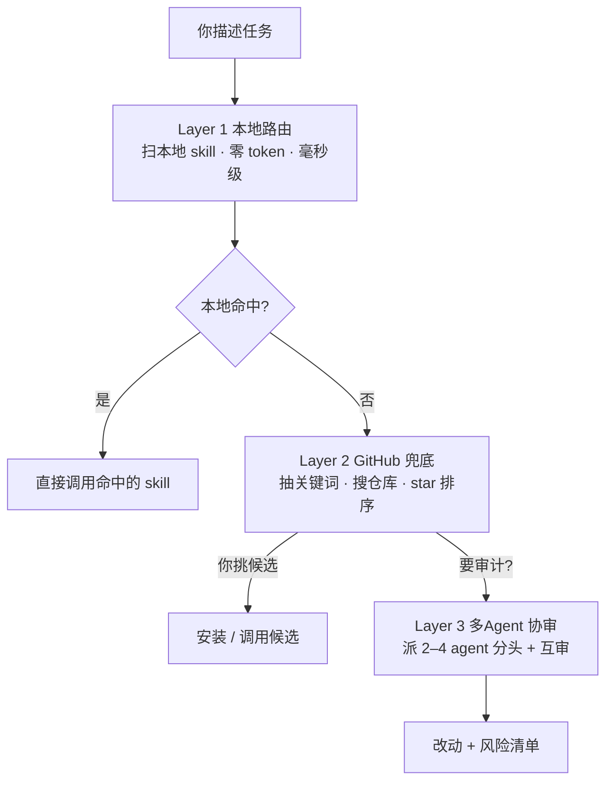
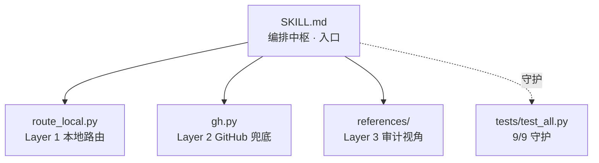

# 技能罗盘

> 一个「skill 路由器 + 多 Agent 审计员」。**核心理念：有现成的轮子，就别从零造**——遇到任务先找现成 skill 复用，同样的活儿别人早干过，直接调用最省时、最省 token；你描述任务，它告诉你用哪个 skill，本地没有就上 GitHub 搜候选；你说"审计一下"，再派几个 agent 从多角度帮你查漏。

> GitHub 仓库 slug：`multi-agent-audit`（URL 仅支持 ASCII，故仓库名沿用英文，技能显示名用中文「技能罗盘」）。

纯 skill 形态，零第三方依赖，装上即用。核心逻辑仅用 Python 标准库实现，测试 **9/9 通过**。

## 30 秒上手

- **"我这个任务该用哪个 skill？"** → 秒回命中，直接调它，不用从零写。
- **"有没有给 PDF 加水印的 skill？"** → 本地没命中就上 GitHub 找候选，你挑。
- **"用多 agent 重写并审计这个接口"** → 派几个 agent 协同做、再互相核对。

## 能做什么 / 不能做什么

| 它能帮你做 | 它不做的 |
| --- | --- |
| 断网跑 Layer 1：按关键词把任务匹配到本地已装 skill，零 token、毫秒级 | 不做语义级精准推荐——只做关键词级匹配 |
| 本地没命中跑 Layer 2：去 GitHub 搜对口 skill 仓库，列带 star/描述的候选让你挑 | 不在你没要求时自动开多 Agent；你点头它才派 |
| 你点名"审计"时跑 Layer 3：派 2–4 个 agent 分头做、再交叉核对 | 不替你拍板装哪个 skill——候选列给你，挑哪个由你定 |

## 为什么需要多 Agent 审计

> **AI 有时候会"骗人"**——它会幻觉、会自信地编造不存在的 API、拼错文件名、把错的讲得头头是道。一个人容易被骗，一群人互相盯着就不一样了。这正是 Layer 3 存在的理由。

| 单一 AI 的坑 | 多 Agent 互审的好处 |
| --- | --- |
| 幻觉：凭空造出不存在的库 / 接口 / 参数，还一脸理直气壮 | 分头实现 + 互相审查，彼此抓漏、互相兜底 |
| 一旦方向跑偏，整条链路都跟着错，没人拉它一把 | 实现 / 审查 / 安全 多视角并行，盲区被覆盖 |
| 错误被当作事实输出，你很难一眼识破 | 多数一致才收敛，单点翻车不再"一错到底" |
| 安全、边界、异常处理这类隐性问题最容易被漏 | 交付「改动 + 风险清单」，哪儿动了、有啥风险你看得见 |

## 三层工作流（按需触发）

```
       你描述任务
            │
            ▼
      ┌──────────────┐
      │  Layer 1      │  扫本地已装 skill，关键词匹配
      │  本地路由     │
      └──────┬───────┘
             │
       命中？├── 是 ──► 直接调命中的 skill（完）
             │
            否
             ▼
      ┌──────────────┐
      │  Layer 2      │  GitHub 搜对口仓库，给候选
      │  GitHub 兜底  │
      └──────┬───────┘
             │
       你挑一个 ──► 安装 / 调用（完）
             │
       要审计？├── 是 ──► Layer 3：派 2–4 个 agent 分头做 + 互审
             │
            否
             ▼
           结束
```

### 示意图（Mermaid）



### Layer 1 — 本地路由
扫描 `~/.workbuddy/skills/`，用 CJK 2/3-gram + 拉丁标识符做关键词匹配，毫秒级、零网络、零 token。

### Layer 2 — GitHub 兜底
本地没命中时，抽取任务关键词、打 GitHub 公开搜索 API 按 star 排序给候选。联网失败会优雅降级为 `{"ok": false}`，绝不崩主流程。

### Layer 3 — 多 Agent 审计（可选 · 自适应宿主）
你明确说"多 agent / 审计 / 一起审"时才触发。优先派 2–4 个 `general-purpose` agent 从实现 / 审查 / 安全等角度分头做再交叉核对；**若你的部署不允许嵌套 agent（沙箱终止 / 禁用），主 agent 会自动降级为分视角自审**，交付物形态完全一致——审计不会因此跳过。要不要并行多 agent，取决于宿主环境是否开放嵌套 agent，本 skill 两种都支持。

## 目录结构

| 文件 | 作用 |
| --- | --- |
| `SKILL.md` | skill 元数据、触发词、三层流程、Agent 指令 |
| `route_local.py` | Layer 1 本地路由（CJK 2/3-gram + 拉丁标识符匹配） |
| `gh.py` | Layer 2 GitHub 兜底搜索（纯 urllib，优雅降级） |
| `tests/test_all.py` | 9/9 单元测试（覆盖扫描 / 打分 / 离线降级） |
| `references/audit-prompts.md` | Layer 3 审查视角的 prompt 清单 |
| `legacy/` | 旧 1.x CDP 注入 daemon 实现（已归档，未删） |

### 模块关系图（Mermaid）



## 安装 / 使用

把本目录放到 `~/.workbuddy/skills/multi-agent-audit/`（或你 WorkBuddy 的用户级 skill 目录）即可，无需 `pip install`。

```bash
# Layer 1：本地路由
python route_local.py "把抖音小店的订单按渠道汇总成表" --top 6

# Layer 2：GitHub 兜底
python gh.py "给 PDF 加水印的 skill" --limit 6
```

## 背景

最早的 1.x 是常驻 daemon：用 CDP 注入往聊天界面塞悬浮球 + 面板，强依赖浏览器远程调试端口，白屏 / 弹窗错位 / CSP 拦截都出过。本版（2.0）砍掉全部 UI 与常驻依赖，改成纯 skill——不碰任何界面、不需调试端口，装上即用。旧实现已整体移入 `legacy/` 保留。
